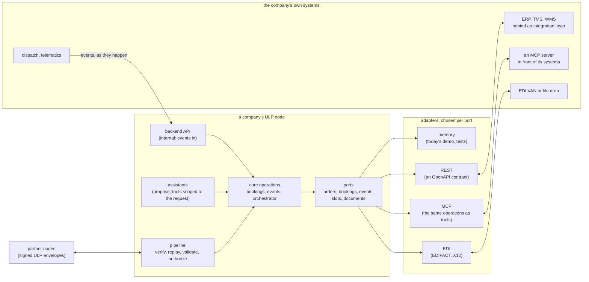
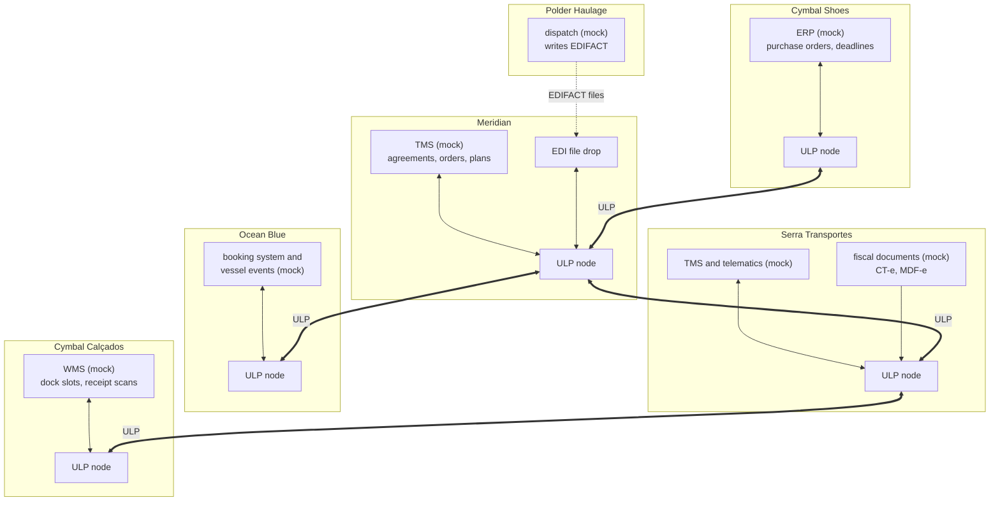
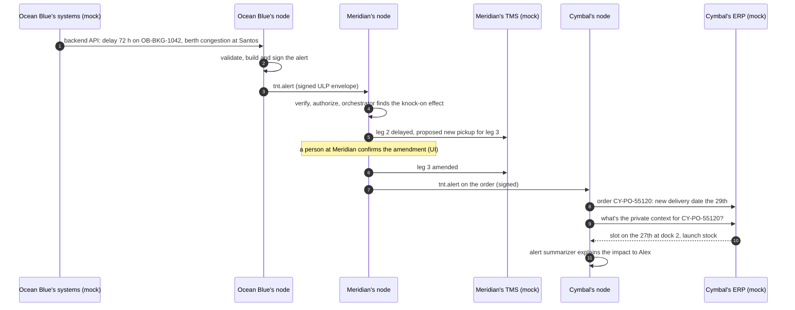
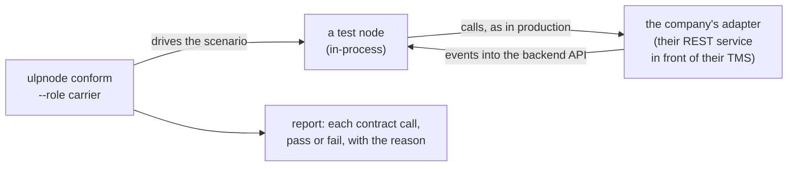

# Proposal: connecting each company's own systems

**Status:** proposal for review (2026-10-13). Nothing here is built. None
of it changes the protocol between companies: it is about the other side
of each node, where it meets the company's own systems.

**Related:** [door to door through a forwarder](door-to-door-forwarder.md)
(the scenario this serves), DESIGN §A.7 (backend connectors, "later"),
§A.8 and §A.9 (each role's internals), and the
[agent runtime proposal](../README.md#proposals) (agents reaching the node
over MCP).

## Why

A company watching the demo asks two questions:
1. "Does this protocol work?" The demo answers that.
2. "**What would we have to build to join?**" The demo doesn't answer that
   yet.

Today every node is self-contained:
- **Bookings and events** live in in-memory stores.
- **The carrier's events** come from a built-in shipment simulator.
- **The shipper's private context** (deadlines, dock slots) is a YAML file.
- **Address books and directories** are YAML files too.

That's right for a demo of the protocol, and wrong for a demo of adoption.
A real carrier's bookings live in its transport management system, its
truck positions come from telematics, and a shipper's purchase orders and
dock slots live in its ERP and warehouse systems. Nobody will re-key them
into a ULP node.

So the node needs a small, explicit **integration surface** on its other
side: a few well-defined calls to and from the company's own systems. The
demo should show it with **mock backends** that behave like the real
thing, so a prospect can see exactly where their systems plug in, and how
much work that is.

## What a company has to connect

For each role, the systems involved and what flows between them and the
node. Arrows are from the point of view of the node: "in" means the node
receives it from the backend, "out" means the node sends it.

### Shipper (Cymbal Shoes)

| Backend | In (backend → node) | Out (node → backend) |
|---|---|---|
| **ERP / order management** | Orders ready to ship: reference, goods, quantities, the buyer, the Incoterm. The private context for each: deadline, receiving slot, why it matters | The booking or order's confirmation, its references, and the journey's events and alerts, so the ERP shows the latest arrival estimate |
| **Partner master data** | The partners the company already works with (today's address book) | none |

### Forwarder (Meridian)

| Backend | In | Out |
|---|---|---|
| **TMS** (transport management) | The forwarder's agreements: which carriers it may use on which lanes, under which contracts. Its customers and their orders | Orders received, plans confirmed, leg bookings and their states, amendments: the TMS stays the system of record |
| **EDI VAN or file drop** | IFTSTA / X12 214 status, APERAK / 990 acknowledgements | IFTMIN / X12 204 instructions (the door-to-door proposal's EDI gateway) |

### Carrier (Ocean Blue, Serra Transportes, Garden State)

| Backend | In | Out |
|---|---|---|
| **TMS / booking system** | The decision on a booking request (accept with references, or decline), its schedule (vessel, voyage, planned times), amendments it accepts | Booking requests and amendments received, verified |
| **Dispatch and telematics** (ocean: terminal and vessel systems) | Events as they happen: picked up, loaded, departed, arrived, delivered; positions; reefer readings; delays with a reason | none |
| **Fiscal documents** (Brazil) | The CT-e or MDF-e's access key and status, once the carrier's systems issued them with the tax authority | The data needed to issue them (the carrier's own systems do the issuing) |

### Receiver (Cymbal Calçados)

| Backend | In | Out |
|---|---|---|
| **WMS / dock scheduling** | Receiving slots; the dock team's confirmation of a delivery (a scan at the dock) | Arrival estimates and alerts, so the dock plan moves with the truck |

Almost everything the demo does today by itself maps onto one of these:

| Today, built into the node | Tomorrow, from the company's system |
|---|---|
| The shipment simulator inventing a voyage | The carrier's dispatch and telematics sending events |
| The booking service assigning references and an eBL | The carrier's TMS deciding and assigning |
| `business.yaml`: deadlines and slots | The shipper's ERP and WMS |
| `addressBook.file` | The company's partner master data |
| In-memory bookings and events | The TMS or ERP as the system of record; the node keeps the signed messages |

## Architecture: ports and adapters

The node's core (the pipeline, authorization, signing, the orchestrator,
the assistants) talks to backends only through **ports**: small Go
interfaces, one per capability above. Each port has **adapters** for the
different ways a company can connect.



What the picture says:

- **Partners only ever reach the pipeline.** A partner's message is
  verified, checked and authorized before any port is touched, exactly as
  today. Backends never see unverified input from another company.
- **Backends only ever reach the core through a port.** No backend writes
  into the node's stores directly, and no backend can make the node sign
  something the core wouldn't.
- **Models never call a backend.** An assistant's tool asks the core for a
  scoped answer ("this order's goods"); the core asks the port. The rule in
  DESIGN §A.7 holds: connectors are called by deterministic code, after
  authorization, for exactly the data the request needs.
- **One port, several adapters.** The same core works against the
  in-memory adapter (today's demo, and tests), a REST backend, an MCP
  server, or an EDI channel. Each company chooses per port.
- **Events come in through the backend API.** The company's dispatch or
  telematics systems tell the node what happened; the node validates, signs
  and publishes, as its simulator does today.

### The adapters

| Adapter | When to use it | What the company provides |
|---|---|---|
| **memory** | The demo and tests; the default | Nothing |
| **REST** | Most enterprise systems: an integration layer, an iPaaS, or a thin service in front of the TMS or ERP | An HTTPS service implementing the port's **OpenAPI contract**, and (for events) calls to the node's backend API |
| **MCP** | A company that already exposes its systems as MCP servers, or wants the same server for its own agents | An MCP server with the port's tools (same operations as the REST contract) |
| **EDI** | Partners and systems that only speak flat files | A VAN or file-drop connection, and the mapping profile (which segments, which codes) |

### The direction of each call

- **The node asks** (pull): "may we accept this booking?", "what's the
  private context for order CY-PO-55120?", "which carriers may we use from
  Rotterdam to Santos?". The node calls the backend through the adapter.
- **The backend tells** (push): "the truck left the warehouse", "the
  vessel is delayed 72 hours", "the dock scanned the delivery". The backend
  calls the node's **backend API**: an internal HTTPS endpoint, separate
  from the public ULP endpoints, authenticated per backend (mTLS or OAuth
  client credentials), on the company's private network or with an
  allowlist.

The backend API is the generalization of today's control socket, which
already lets `ulpnode book` and `ulpctl disrupt` act on a running node.
What arrives there is trusted to the extent that the company trusts its
own systems, but it is still validated: schema, sizes, references that
must exist, the same strictness as the protocol's bodies. A backend bug
shouldn't become a malformed signed message to a partner.

## How it looks in the door-to-door story



Each company has its node and, behind it, a mock of the system it would
really connect. Polder has no node at all: its mock dispatch system only
writes EDIFACT files, as the door-to-door proposal describes.

### A delay, from the vessel to Cymbal's ERP



Three things to notice:
- **The protocol messages are the same as today.** Only where the data
  comes from (step 1) and where it goes (steps 5, 7, 9) changed.
- **Private context now comes from the ERP**, fetched by deterministic
  code for one authorized order, and still never leaves Cymbal.
- **The TMS stays the forwarder's system of record.** The node records
  what was signed and sent; the TMS records the business state.

## The mock backends

The demo ships a mock for each backend in the story. Each one is:

- **A small Go service** (`cmd/ulpmock`, one binary with a subcommand per
  backend: `erp`, `tms`, `dispatch`, `wms`, `fiscal`, `edi`), implementing
  the same OpenAPI contract a real integration would.
- **Seeded with the story's data:** Cymbal's purchase orders and slots,
  Meridian's carrier agreements, Serra's fleet, Cymbal Calçados' dock plan.
- **Scriptable:** the dispatch mock moves a truck through its stops and
  posts events to its node, replacing today's simulator for road legs; the
  vessel mock does the same for the ocean leg; Polder's mock writes
  EDIFACT files on the same schedule.
- **Visible:** each has a one-page UI showing its state, in the demo's
  look: the ERP's order and its arrival estimate, the TMS's plan, the
  fiscal mock's issued CT-e, Polder's outgoing EDI folder. On the
  presenter screen, each company's node sits next to its backend, so the
  audience sees where their own system would be.

A Go mock, rather than a generic mocking tool, because it has to behave:
accept or decline bookings by rules, move trucks on a schedule, issue
documents with keys, and be deterministic in tests. The OpenAPI contracts
are published alongside, so a company can still point WireMock, Mockoon or
Prism at them to test its side without our code.

## What a company would build

For each role, an **integration guide** (`docs/guides/integrating-*.md`)
says, concretely:

1. **Which ports it must connect**, and which are optional. A carrier
   needs bookings and events; fiscal documents only in Brazil.
2. **The contract for each:** the OpenAPI document (and the equivalent MCP
   tools), with examples taken from the mocks.
3. **How to authenticate** the node and the backend to each other.
4. **What the node guarantees:** it never forwards unverified partner data
   to a backend; it calls the backend only for authorized requests; it
   doesn't retry non-idempotent calls without an idempotency key.
5. **What the backend must guarantee:** stable references, idempotent
   event posting (the event ID is the key), times in UTC.

And a **conformance kit**, so "are we done?" has an answer:



The kit runs the story's scenes against the company's own adapter: a
booking request arrives, the adapter must accept it with references; the
adapter posts a departure event, the node must accept and sign it; a
malformed event must be refused. It's the same idea as our golden vectors
for the envelope, applied to the integration side.

## Configuration

Each port is configured in the node's YAML, defaulting to today's
behaviour:

```yaml
backends:
  orders:                       # shipper: ERP / OMS
    adapter: rest
    url: https://erp-gateway.internal.cymbal-shoes.example/ulp
    auth: { oauthClientEnv: ERP_CLIENT, scopes: [orders.read] }
  events:                       # carrier: dispatch and telematics push here
    adapter: rest               # the backend API accepts this backend's calls
    allow: { mtlsSubject: "CN=dispatch.serra-transportes.example" }
  documents:                    # Brazil: fiscal documents
    adapter: rest
    url: https://fiscal.internal.serra-transportes.example
  agreements:                   # forwarder: carrier agreements in the TMS
    adapter: mcp
    server: https://tms-mcp.internal.meridian-forwarding.example/mcp
```

A port that isn't configured uses the memory adapter, so every existing
config keeps working, and the demo can switch one company at a time from
built-in data to its mock backend.

## What it doesn't change

- **The protocol.** Envelopes, intents, bodies and discovery are the same.
  Partners can't tell whether a node's data comes from memory or from an
  SAP system, and shouldn't.
- **The hard rules.** Verification and authorization before any backend
  call; private context never in an envelope; models propose and code
  acts; a person confirms external effects.
- **What's standardized.** ULP standardizes what companies exchange. The
  backend contracts are this implementation's integration product: useful,
  documented, versioned, but not part of the protocol. Another ULP
  implementation may integrate differently.

## Phases

1. **Ports with memory adapters.** Refactor the stores, the simulator and
   the business file behind ports, with no behaviour change, and add the
   backend API (events in) beside the control socket. This is the
   groundwork everything else needs.
2. **The first two mocks, in today's demo.** Cymbal's ERP (orders and
   private context, replacing `business.yaml`) and Ocean Blue's vessel
   events (replacing the simulator), over REST, with their one-page UIs.
   The two-company demo then shows "here's where your system plugs in".
3. **The door-to-door mocks.** Meridian's TMS (agreements, plans) and the
   EDI file drop with Polder's mock; Serra's TMS, telematics and the
   fiscal mock; Cymbal Calçados' WMS. Built alongside the door-to-door
   proposal's phase 1.
4. **The MCP adapter, the integration guides and the conformance kit.**
5. **The North American variant's mocks** (DSDC-style TMS data, X12 EDI),
   mostly reusing phase 3.

## Open questions

1. **System of record.** For each piece of data, who owns it: the backend
   (the TMS decides bookings) or the node (it holds the signed messages)?
   The proposal says the backend owns business state and the node owns the
   evidence; edge cases (a booking the TMS later cancels) need rules.
2. **Synchronous decisions.** A booking request today gets an immediate
   confirmation. If the carrier's TMS takes minutes or a person, the
   protocol needs the asynchronous answer DESIGN already lists as later
   work (an A2A task, or a "received, decision to follow" reply).
3. **How generic the contracts are.** One contract per port for every
   company, or room for company-specific fields? Starting minimal, with an
   `extensions` member, is probably right.
4. **REST first, or MCP first?** REST is what enterprise integration teams
   build today; MCP is where agents are going. The proposal supports both
   per port; which one the guides lead with is a choice for the audience.
5. **Where the mocks run in the hosted demo:** one Cloud Run service per
   mock, or each mock inside its company's node container for simplicity.
6. **Hosting real nodes.** A company that wants a node but not to run one
   needs a hosted option, with its backend adapters reaching into its
   network. That's a product question beyond this proposal.

## Not in scope

The real connectors to specific products (SAP, Oracle, CargoWise, Blue
Yonder, a particular telematics vendor), which are what a company or a
partner builds with the guides and the kit; production concerns such as
persistence and high availability; and issuing fiscal documents, which
stays with each carrier's own certified systems.
