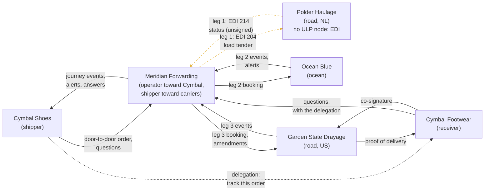
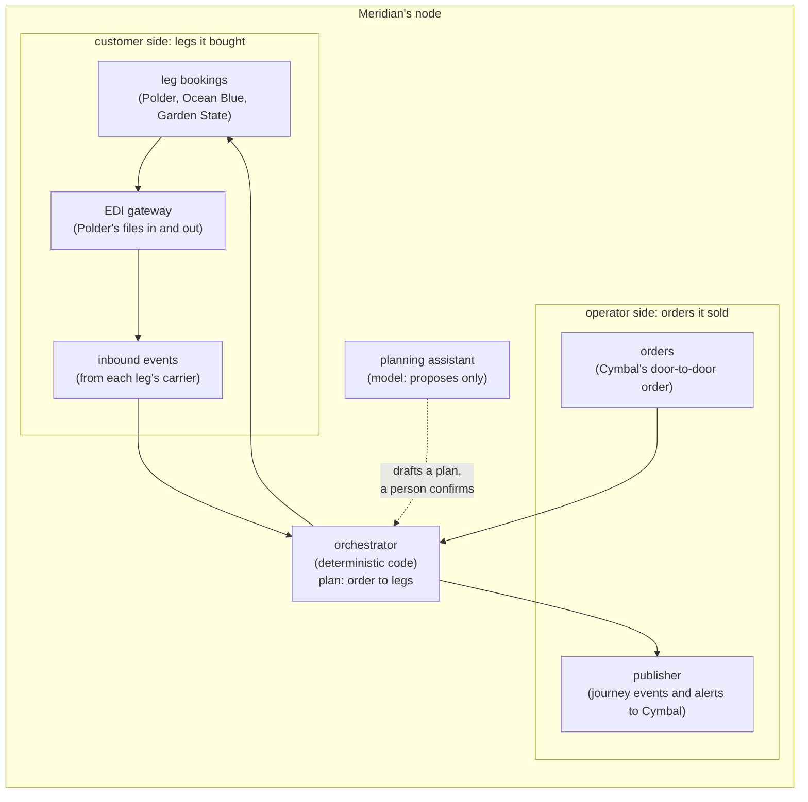
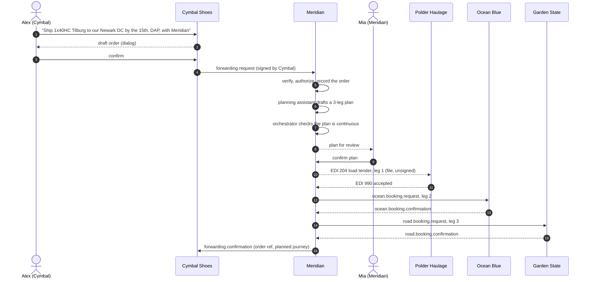
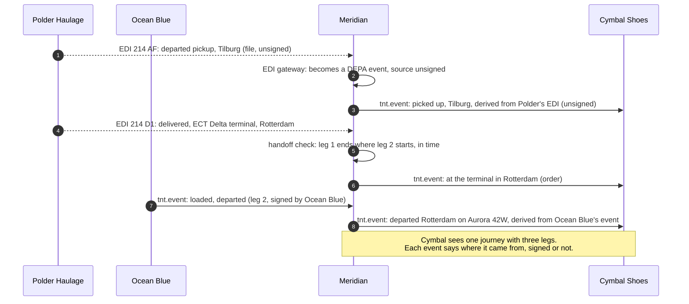
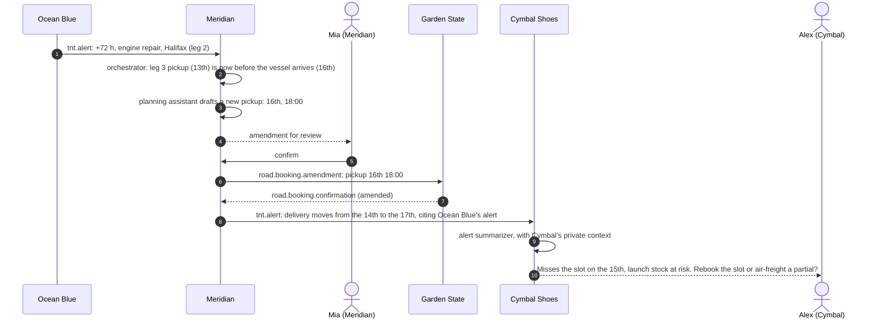
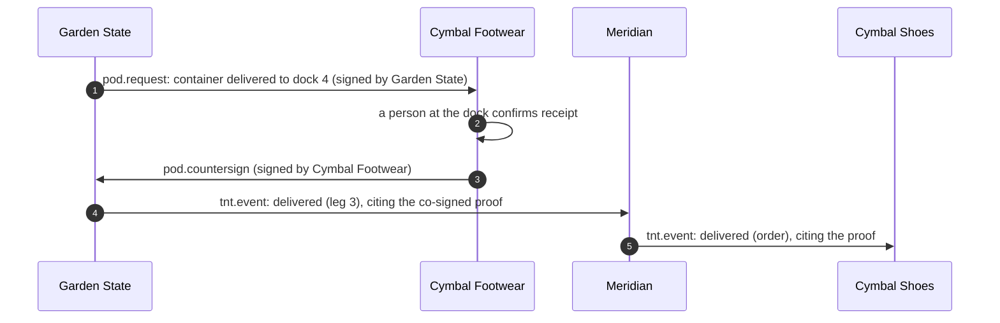
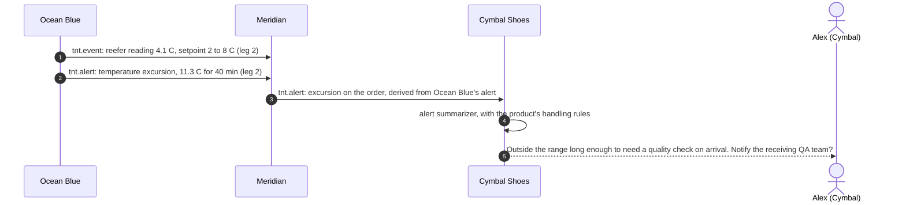

# Proposal: door to door through a freight forwarder

**Status:** proposal for review (2026-10-12; revised 2026-10-13: a legacy
carrier in the core, continuity checks, a cold-chain variant). Nothing here
is built.
Parts of it are protocol changes (new intents and bodies), flagged where
they appear; the rest builds on what the demo already has.

**Related:** #80 (the truck leg and proof of delivery), #83 (the route
map), #103 (multi-hop), delegation (milestone 7), and the background in
[multi-leg freight shipping](../reference/multi-leg-freight-and-api-orchestration.md).

**See it move:** [`door-to-door-forwarder.html`](door-to-door-forwarder.html)
walks through every message in this proposal, step by step, showing each
envelope and what each company knows after it. It's one self-contained
file: download it and open it in a browser (GitHub shows its source).

## Why

The demo we have is real in its mechanics. Every message is signed by the
company that sent it and checked against keys that company publishes at
its own domain. The payloads are the industry's (DCSA for ocean). A model
proposes and a person confirms anything that leaves the company. Gemini
Enterprise can drive a company's node as that company's own agent.

Its business shape is simpler than the real world:

- **Who books is never stated.** In practice the Incoterm in the sales
  contract decides whether the seller or the buyer arranges transport, and
  how far. Our demo quietly assumes the seller books.
- **The shipper calls the ocean carrier directly.** Large shippers with
  carrier contracts do, but most cargo moves through a **freight
  forwarder**: the shipper signs one contract, and the forwarder books and
  manages every leg behind the scenes.
- **The journey is one leg, port to port.** A real shipment is door to
  door: a truck from the seller's warehouse to the port, the ship, and a
  truck from the port to the buyer's dock.
- **Tracking comes straight from the one carrier.** In practice someone
  stitches several carriers' tracking into one journey: the forwarder, or a
  visibility platform acting as a control tower.
- **Every carrier speaks the same modern protocol.** In practice many,
  especially small truckers, send flat-file EDI (status messages such as
  EDI 214) over a file drop or a VAN, and the forwarder translates. A
  protocol that only works once everyone has adopted it isn't one a
  forwarder can use on Monday.

This proposal makes the demo's story match that shape, without giving up
anything the demo stands for: no central database, no party seeing more
than its share, every message signed by whoever sent it (and data that
isn't signed marked as such), and a person confirming anything with an
external effect.

## The story

Cymbal Shoes sells a container of sneakers to Cymbal Footwear, its US
retail arm, on **DAP Newark** terms (*Delivered At Place*): Cymbal Shoes
arranges and pays for transport to Cymbal Footwear's distribution center;
Cymbal Footwear handles US import. So it's Cymbal Shoes that hires a
forwarder.

The cargo starts at Cymbal's European warehouse in Tilburg, crosses the
Atlantic on Ocean Blue's *Aurora* from Rotterdam to Newark, and ends at
dock 4 of the Newark distribution center, where a receiving slot is booked
for Thursday the 15th.

### The cast

| Company | Role in this story | Domain (demo) | Node roles |
|---|---|---|---|
| **Cymbal Shoes** | Seller; it hires the forwarder (DAP) | `cymbal-shoes.example` | shipper |
| **Meridian Forwarding** | Freight forwarder: one contract with Cymbal, books every leg, and tracks the whole journey | `meridian-forwarding.example` | operator (toward Cymbal) and shipper (toward the carriers) |
| **Polder Haulage** | Trucker: Tilburg warehouse to the port of Rotterdam. A small carrier **without a ULP node**: it takes load tenders and sends status messages as EDI | `polder-haulage.example` (no profile, no keys) | none |
| **Ocean Blue** | Ocean carrier: Rotterdam to Newark | `ocean-blue.example` | operator |
| **Garden State Drayage** | Trucker: port of Newark to the distribution center | `garden-state-drayage.example` | operator |
| **Cymbal Footwear** | Buyer and consignee: receives, and signs for delivery | `cymbal-footwear.example` | receiver |

All names are fictional demo brands. Meridian, Polder and Garden State are
new; the rest exist today. Polder is deliberately a legacy carrier: most
real journeys have at least one, and how a ULP node lives next to it is
part of the story.

**Had the terms been different,** the same protocol tells a different
story. Under *Ex Works* (EXW), Cymbal Footwear would hire Meridian and
Cymbal Shoes would only hand over the container at its warehouse; under
*CIF Newark*, Cymbal Shoes would pay as far as the port of Newark and
Cymbal Footwear would book the last truck. Nothing in the protocol changes
between these: who sends the first booking does. That is worth one slide
in the demo.

### What happens, scene by scene

1. **One order.** Cymbal Shoes' assistant drafts a door-to-door order for
   Meridian: pick up in Tilburg, deliver to the Newark distribution center
   by the 15th, one 40-foot high-cube, DAP. A person at Cymbal confirms it,
   and Cymbal's node sends it signed.
2. **The forwarder plans.** Meridian's node accepts the order and proposes
   a plan: three legs, with carriers and dates. Meridian's planning
   assistant drafts the leg bookings; the node checks that the plan is
   **continuous** (each leg starts at the facility where the previous one
   ends); a person at Meridian reviews the plan and confirms. Meridian's
   node sends Ocean Blue and Garden State their bookings as signed ULP
   messages, and Polder its leg as an **EDI load tender**. Each carrier
   sees only its own leg.
3. **The journey runs.** Polder picks up the container and delivers it to
   the Rotterdam terminal, reporting both as **EDI status messages**;
   Meridian's node translates them into the same events as everyone
   else's, marked as **unsigned, vouched for by Meridian**. At the
   handoff, the node checks that Polder delivered to the terminal Ocean
   Blue loads from. Ocean Blue loads the container and sails, and reports
   in signed ULP events. Meridian relates each event to Cymbal's order and
   tells Cymbal what happened, as one journey.
4. **A delay, and a cascade.** Ocean Blue reports a 72-hour delay
   (engine repair, Halifax). Meridian's node sees that Garden State's
   pickup at Newark is now impossible, and its planner drafts a new pickup
   time. A person at Meridian confirms, and Meridian sends Garden State an
   amendment. Cymbal gets **one** alert from Meridian: the new arrival at
   the distribution center, and that it misses the slot on the 15th.
   Cymbal's assistant explains what that means for the launch, from
   Cymbal's private context.
5. **The receiver joins.** Cymbal Shoes grants Cymbal Footwear tracking of
   the order (a signed delegation, milestone 7). Cymbal Footwear's node can
   now ask Meridian where the container is.
6. **Delivery.** Garden State delivers to dock 4. Its driver's proof of
   delivery is signed by Garden State and co-signed by Cymbal Footwear;
   both nodes check the other's signature and keep the proof. Meridian
   relays "delivered" to Cymbal Shoes, citing the proof.
7. **Optional: a cold-chain variant.** The same journey with
   temperature-sensitive cargo in a refrigerated (reefer) container. Ocean
   Blue's events carry the container's temperature readings; when the
   temperature leaves the agreed range, Ocean Blue raises an excursion
   alert, Meridian relays it, and Cymbal's assistant explains what it means
   for the goods. Same flows; higher stakes.

Scenes 1 to 4 are the core, including the legacy carrier. Scene 5 needs
delegation, scene 6 the proof of delivery from #80, and scene 7 is a
variant to show when the audience ships perishables or pharmaceuticals.

## Architecture

### Who talks to whom

Every solid arrow is a signed ULP envelope between two companies; the
dashed yellow ones to Polder are EDI files, with no signature. Nobody talks
to a carrier of a leg it didn't book, and no message is relayed through a
third party: Meridian receives a carrier's event and, separately, sends its
own message to Cymbal.

What this picture says, in words:

- **Cymbal Shoes has one counterparty**, Meridian, exactly as in real
  forwarding. It never learns that Polder or Garden State exist unless
  Meridian tells it; it doesn't need to.
- **Each carrier has one counterparty**, Meridian, the shipper of its leg.
  Polder doesn't know about Garden State, and neither knows Cymbal's
  deadline.
- **Polder isn't on ULP at all**, and that's fine: Meridian talks to it
  the way forwarders talk to small truckers today, and translates.
- **Meridian is the control tower**, because it holds the only relationship
  with every leg. That's the realistic answer to "who sees the whole
  journey?": the party that booked it.
- **Cymbal Footwear** reaches Meridian only through Cymbal Shoes'
  delegation, and Garden State only through the delivery itself.

### Inside the forwarder's node

The forwarder is one company in two roles at once, which our nodes already
support (DESIGN §A.6): toward Cymbal it is the carrier of a door-to-door
order; toward Polder, Ocean Blue and Garden State it is the shipper of each
leg. Today a node keeps each role's records apart and nothing reads across
them. A forwarder's whole job is to read across: an event on a leg it
booked becomes news on an order it sold.

So the proposal adds one component, the **orchestrator**, and makes it the
only bridge between the two sides.

The orchestrator's rules:

- **It is code, not a model.** It holds a **plan** per order: which leg
  bookings serve which order, in which sequence, with which planned times.
  It maps events through the plan and nothing else.
- **It checks that the journey is continuous.** Before a plan can be
  confirmed, each leg must start at the facility where the previous leg
  ends, and no later than it ends: Polder's delivery is Ocean Blue's
  terminal of loading; Ocean Blue's discharge is Garden State's pickup.
  While the journey runs, it checks each handoff the same way: if a
  carrier reports delivering somewhere other than where the next leg
  starts, or after the next leg was due to start, it raises an alert to a
  person at Meridian before anything is passed on.
- **It moves only what the plan names.** An event on leg 2 becomes a
  journey event on the order: the milestone, the location, the time, and a
  citation of the carrier's event it came from. Nothing else from one side
  reaches the other: not Ocean Blue's other bookings, not Cymbal's notes.
- **Each carrier gets only its leg.** A leg booking carries that leg's
  cargo, places and times. The order's final destination, its deadline and
  the buyer stay with Meridian unless a leg needs them (Garden State needs
  the delivery address; Polder doesn't).
- **The model proposes, a person decides.** The planning assistant drafts a
  plan and amendments from the order and the carriers' answers; a person at
  Meridian confirms each before any leg booking or amendment is sent, as
  every external effect in the demo requires.

### A carrier without a node

Polder Haulage has no ULP node, no published keys and no profile: it runs
a small dispatch system that takes **EDI 204** load tenders and sends
**EDI 214** shipment status messages through a file drop. Meridian's node
has an **EDI gateway** on its customer side for carriers like this:

- **Out:** when a person confirms the plan, the gateway turns leg 1 into
  an EDI 204 tender (and takes Polder's EDI 990 acceptance back).
- **In:** each EDI 214 status becomes the same track & trace event every
  other carrier sends (`AF`, departed pickup, becomes `DEPA`; `D1`,
  delivered, becomes `ARRI` at the terminal), with Polder's SCAC and the
  facility mapped to the standard identifiers the plan uses.
- **Provenance stays honest.** These events carry no carrier signature.
  Meridian vouches for them: in what it tells Cymbal, `derived_from` says
  the source was an unsigned EDI message from Polder, and Cymbal's journey
  shows that mark differently from a signed one. Nothing pretends an EDI
  file is a ULP message.
- **The rest of the journey doesn't care.** The orchestrator, the
  continuity check and Cymbal's view work the same for every leg.
  Replacing Polder with a ULP carrier later changes the gateway's input,
  nothing else.

In the demo, Polder is a small mock that writes EDI files as the simulated
truck moves, so the gateway reads real flat files, not JSON pretending to
be EDI.

### Places: standard identifiers first

Every place in a plan is a **facility with a standard identifier**: a
UN/LOCODE for the port or town, and a terminal or warehouse code where one
exists (an SMDG terminal code for Rotterdam's ECT Delta, for example). The
continuity check compares those. Precise coordinates, as a Plus Code or a
geospatial cell, may ride along as optional metadata on a facility, useful
for a map or for a "the truck stopped somewhere else" check, but nothing
depends on them: the industry identifies places by code and address, and
a check that only works with coordinates wouldn't match its data.

### What the deadline is, and isn't

Today Cymbal's deadline is private: it stays in Cymbal's business context
and never goes in an envelope. With a forwarder, the **delivery window** is
part of the contract: Meridian can't plan without it, so it goes in the
order. What stays private is **why**: the product launch, the receiving
slot's dock and window, the cost of missing it. Cymbal's assistant still
uses those to explain what a delay means; Meridian never sees them.

## How the messages flow

### Booking: one order becomes three legs

Steps 4, 12 to 15 and 16 are signed envelopes between two companies, each
verified against the sender's published keys before anything else
happens. Steps 10 and 11 are EDI files with Polder, outside ULP: what any
forwarder does with a carrier that has no API. Step 16 could also come
first, with the plan to follow; the confirmation carrying the planned
journey is simpler to show.

### Execution: carriers report, the forwarder tells one story

### Disruption: one delay, a cascade, one alert

This is the scene that shows what a forwarder is for, and what agents can
do inside the rules: Meridian's assistant finds the knock-on effect and
drafts the fix in seconds, but a person sends it.

### Delivery: proof signed by both sides

### Cold-chain variant: an excursion

The readings come from the reefer container's own controller, reported by
the carrier in its signed events. Which readings to report, and what counts
as an excursion, are agreed in the booking; what the excursion means for
the product (discard, test, or accept) is the cargo owner's knowledge, in
its private context, as the delivery slot is today.

## What changes in the protocol

Most of the demo carries over unchanged: the envelope, signing, discovery,
replay protection, the pipeline, the subscription and push model, and the
authorization rules, which already decide per booking who a party is. The
new parts:

| What | Why | Protocol change? |
|---|---|---|
| `ulp.forwarding.request` / `.confirmation` | A door-to-door order: places (door or port at each end), cargo, delivery window, Incoterm; answered with the forwarder's reference and the planned journey | **Yes**: new intents and bodies |
| `ulp.road.booking.request` / `.confirmation` | A truck leg with a carrier that has a node (Garden State), in pf's DSDC truckload payload (#80) | **Yes**: new intents, a second dialect |
| `ulp.road.booking.amendment` | Moving a pickup or delivery time without cancelling | **Yes**: new intent |
| Road events | The same track & trace event payload with road event codes (#80) | Body values only |
| `derived_from` on a forwarder's events and alerts | Where an order event came from: a carrier's signed event or alert ID, or an unsigned source (an EDI message, with its control number), so a customer can tell evidence from hearsay and ask for it | **Yes**: an optional member |
| Facility identifiers on places | The terminal or warehouse a leg starts and ends at, beside the UN/LOCODE, so plans and handoffs can be checked; optional coordinates as metadata | **Yes**: optional members |
| Reefer readings and excursion alerts (cold-chain variant) | Temperature setpoint and readings on a reefer container's events, and an alert kind for an excursion; DCSA's reefer work is the place to take field names from | **Yes**: optional members, a new alert kind |
| EDI with a legacy carrier | Load tenders out (EDI 204) and status in (EDI 214), through Meridian's gateway | **No**: it never touches ULP; only `derived_from` records it |
| `pod.request` / `pod.countersign` | Proof of delivery signed by the carrier and the receiver (#80) | **Yes**: new intents |
| Delegation | The receiver tracking the order (milestone 7, already designed) | Already planned |

Each is a protocol change in our sense: new intents or members mean new
golden vectors, generated deliberately in the PR that adds them. Where pf
defines a payload (DSDC truckload, custody transfer proof), we take pf's
field names exactly, as we did for ocean.

**What doesn't change:** no new party role is needed on the wire. A
forwarder is a node with the operator and shipper roles; the authorization
rules work per booking, so Meridian is the operator on Cymbal's order and
the shipper on each leg, and every existing rule already says the right
thing for both. A profile may later advertise `forwarder` as an informative
role, for directories; nothing would depend on it.

### Authorization, intent by intent

| Intent | Allowed if |
|---|---|
| `forwarding.request` | The sender isn't denied (as booking requests today); the forwarder may decline |
| `road.booking.request` | As `ocean.booking.request` |
| `road.booking.amendment` | `sender == booking.shipper` of that leg |
| `tnt.event` / `tnt.alert` at the forwarder | `sender == booking.operator` of that leg, with an active subscription (unchanged rule) |
| `tnt.event` / `tnt.alert` at Cymbal | `sender == order.operator`, that is Meridian (unchanged rule) |
| `tnt.inquiry` to the forwarder | `sender == order.shipper`, or a delegate with `tnt:read` (milestone 7; unchanged rule) |
| `pod.request` | `sender` is the operator of a leg whose consignee is the receiver, and the receiver holds a delegation for the order |
| `pod.countersign` | In reply to a `pod.request` the receiver accepted |

The new rule is the last two: a receiver must know the delivery is real
before it signs. Everything above them is today's table applied to new
intents.

## The hard question: re-issue or pass through?

When Ocean Blue reports a delay on leg 2, what does Cymbal receive?

**Re-issue (proposed for now).** Meridian sends Cymbal its own signed
alert about the order, with `derived_from` naming Ocean Blue's alert.
Cymbal trusts Meridian, its counterparty, which is how forwarding works
today. If Cymbal wants the evidence, it asks Meridian, which holds Ocean
Blue's signed alert and can produce it.

**Pass through (later).** Meridian forwards Ocean Blue's own signed alert,
so Cymbal can verify Ocean Blue's signature itself, without trusting
Meridian's account of it. That's a stronger story for ULP, and it raises
real questions:

| | Re-issue | Pass through |
|---|---|---|
| Who Cymbal trusts | Meridian | Ocean Blue, checked directly |
| What Cymbal learns | What Meridian chooses to say | The carrier's message as sent: its booking reference, its wording |
| Fits today's rules | Yes: Meridian is the order's operator | No: a message whose sender isn't Cymbal's counterparty, nested in one that is |
| Replay and freshness | Unchanged | Needs rules for a nested message that is older than its wrapper |
| Data minimization | Meridian decides what to share | The carrier's whole event goes to someone it never dealt with |

Our recommendation: build re-issue with `derived_from` now; design pass
through with #103 (multi-hop) once someone needs it. It's the same rule we
apply everywhere: verify what you process, and process only what your
counterparty sent you.

## The agents

| Agent | Where | What it may do | What it may not |
|---|---|---|---|
| Cymbal's assistant (exists) | Cymbal Shoes, customer side | Draft the order for Meridian; explain the journey and alerts; ask Meridian questions | Send anything without a person; see anything of Meridian's but what Meridian sent |
| Cymbal's alert summarizer (exists) | Cymbal Shoes | Explain an alert with Cymbal's private context | Leave the company |
| **Meridian's planning assistant** (new) | Meridian, both sides, through the orchestrator | Draft a plan and amendments from an order, the carriers' confirmations and their events | See an order's free-text notes; send a booking or an amendment; read a leg not in the plan |
| Meridian's inquiry responder | Meridian, operator side | Answer Cymbal's questions about the order, from the order's journey and the events it derived from | Reveal carriers' references or other customers' orders |
| Ocean Blue's assistant (exists) | Ocean Blue | Unchanged | Unchanged |

**The planning assistant is the one design risk.** Every model in the demo
today works within one role, because a model that reads one party's data
and writes messages to another is how prompt injection exfiltrates data.
The planner has to read an order and draft bookings to carriers: that's
the job. The proposal contains it three ways:

1. it sees only the fields the plan maps (places, cargo, window), never
   the order's free text or the customer's identity beyond what a leg
   needs;
2. it drafts; the orchestrator builds each leg booking from the confirmed
   plan, field by field, with deterministic code;
3. a person confirms every plan and amendment, seeing exactly what each
   carrier will receive.

## What people see

- **Cymbal Shoes' UI:** one order, with a journey strip of three legs by
  mode (truck, ship, truck), each event marked with where it came from: a
  carrier's signed event, or an unsigned source Meridian vouches for.
  The route map (#83) draws the road legs too. Cymbal's Activity shows
  only its messages with Meridian.
- **Meridian's UI:** two views, as today's multi-role nodes have:
  *Orders* (what it sold, the operator side) and *Legs* (what it bought,
  the customer side), and between them the **plan**: each order, its legs
  and their state, the cascade when something slips. Meridian's assistant
  lives here.
- **Each carrier's UI:** its own booking only, with Meridian as the
  customer. Garden State's shows the amendment arriving.
- **Cymbal Footwear's UI:** the order it was granted, and a "sign for
  delivery" action behind the usual confirmation.
- **The presenter view:** each company's own screen side by side (locally;
  on Cloud Run, tabs), never a merged "god view". That contrast with a
  central control-tower database is the point of the demo.

## Phases

1. **Door to door, with a legacy carrier.** Scenes 1 to 4:
   - Meridian as a new node, the forwarding order, and the orchestrator
     with re-issue, `derived_from` and the continuity checks;
   - Polder as a mocked legacy carrier behind Meridian's EDI gateway
     (tenders out, status in, unsigned provenance);
   - Garden State for the last leg (road booking, events, amendment);
   - the delay cascade;
   - the journey strip with three legs, marking unsigned sources.
2. **The receiver.** Delegation (milestone 7); proof of delivery co-signed
   by Cymbal Footwear. Scenes 5 and 6. The route map draws the road legs.
3. **The cold-chain variant.** A reefer container, readings on Ocean
   Blue's events, an excursion alert relayed by Meridian. Scene 7.
4. **Pass through,** if wanted, designed with #103.

Each phase is demo-able on its own. Phase 1 adds two nodes (Meridian and
Garden State) and the Polder mock to the local rig and the Cloud Run
deployment (one service per company with a node).

## Open questions

1. **Order or booking?** Is a forwarding order its own intent
   (`forwarding.request`), or an ocean booking request with door-to-door
   places? A separate intent is clearer and doesn't pretend to be DCSA; it
   is also one more thing to standardize. Does pf define one?
2. **Who tells the destination trucker the vessel's arrival?** In this
   proposal Meridian does, by amending leg 3. The alternative is a
   delegation letting Garden State ask Ocean Blue directly; more ULP, less
   like how drayage is dispatched today.
3. **What a carrier may know about the cargo's final destination.** Garden
   State needs the delivery address; does it need the consignee's name?
   Customs (out of scope here) would need more.
4. **Plans that change shape.** A missed sailing may mean another carrier
   altogether: cancelling a leg and booking a new one, not amending. The
   first version handles time changes only.
5. **Advertising the forwarder role** in profiles and the directory: useful
   for "find a forwarder Tilburg to Newark", not needed for trust.
6. **How much EDI to speak.** EDI 204, 990 and 214 cover tendering and
   status for trucking. Ocean terminals use other messages (EDI 322 for
   terminal and vessel milestones). The demo needs only the trucker's;
   which others are worth mocking depends on the audience.
7. **The continuity check's tolerance.** A handoff at the right facility
   but hours late may be fine (the container waits at the terminal) or
   not (the vessel sailed). The first version flags any handoff after the
   next leg's planned start; a real one needs per-facility rules.
8. **Visibility models elsewhere.** Some ULP designs let any party on a
   journey see all of it. This proposal deliberately doesn't: each party
   sees what its counterparties send it. If the wider protocol settles
   differently, this demo is the place to show the trade-off.

## Not in scope

- **Autonomous negotiation between agents.** The plan is drafted by a
  model and decided by a person, and carriers are booked under the
  forwarder's existing agreements with them, not haggled with at booking
  time. That is how forwarders work.
- **Payment and escrow on delivery.** DESIGN's out-of-scope list has signed
  invoices as the next step; a co-signed proof of delivery is what one
  would key off.
- **Customs and import clearance** (a customs broker's role), rates and
  quotes, air, rail and last-mile drones, splitting a shipment across
  containers, and persistence (the stores stay in memory).
